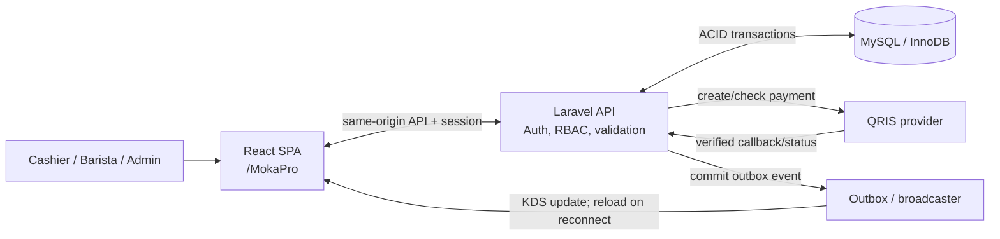

# MokaPro Backend Design

**Status:** Draft for user review. This document describes the proposed implementation; it does not authorize implementation until reviewed.

## Goal

Turn the existing React/Laravel prototype into a coherent, deployable POS MVP without replacing the application wholesale. Laravel is the source of truth for shared operational data. The React application and Laravel API are served from one origin, and backend modules are implemented and validated in small, ordered slices.

Success means:

- The backend dependency lock can be installed with the available PHP runtime.
- The Laravel application boots, migrations run, and tests cover the supported database behavior.
- Authentication and role checks are performed by the server.
- Products, recipes, orders, payment state, inventory, KDS, shifts, and reports use persistent backend data instead of independent browser `localStorage`.
- Totals, payment state, stock movement, and KDS visibility follow explicit server-side rules.
- The published application does not claim a QRIS transaction succeeded without a verified provider result.

## Evidence and current state

- `frontend/src/pages/Cashier/Cashier.jsx` currently saves transactions and KDS orders to `localStorage`. Admin menu, inventory, reports, history, and shift pages also use browser storage.
- `frontend/src/components/PinLogin/PinLogin.jsx` accepts any PIN of at least four characters and contains client-side expected PIN behavior. The value shown in the UI is not a real authentication boundary.
- `frontend/src/components/PaymentModal/PaymentModal.jsx` contains a visual QR placeholder, not a provider-generated dynamic QR.
- The Laravel API currently has `GET /api/products` and `POST /api/orders`. The order controller accepts broad string values, generates a short random order number, and does not model verified payment attempts, shifts, recipes, inventory, or KDS state.
- The Laravel product schema has no active flag, recipe, modifier, or inventory relationship. Existing order and order-item migrations are a useful base, but are not the complete MVP data model.
- `backend/composer.json` declares PHP `^8.3`, while the locked Symfony 8.1 dependencies require PHP 8.4.1+. PHP 8.3.28 is the currently available runtime.
- Laravel database configuration already supports MySQL and SQLite. The environment example currently selects SQLite.
- Existing backend tests are framework examples; they do not exercise POS workflows.
- The supporting Markdown specification defines the business scope and marks many decisions as assumptions. The draft MySQL schema is explicitly not yet validated. The WBS/schedule/RAB PDFs contain mismatched project names or placeholder/inconsistent dates and are not treated as technical requirements.

## Scope

### In scope

- PHP/Composer compatibility and repeatable backend setup.
- MySQL/InnoDB production schema expressed as Laravel migrations.
- Employee identity, PIN authentication, sessions, and role-based authorization.
- Product/category, modifier, recipe versioning, and table availability.
- Order creation and server-calculated snapshots/totals.
- Cash payments, idempotency, receipts, payment records, and a provider boundary for QRIS.
- Inventory, restocking, reservations, stock movements, and low-stock calculation.
- KDS state transitions and reliable publication of paid orders.
- Shift opening/closing, cash reconciliation, reports, API/frontend integration, and end-to-end validation.
- Same-origin hosting: Laravel serves the built React app and `/api` routes.

### Out of scope for this implementation

- Staff attendance and fingerprint devices.
- Automatic refunds, split payment, multi-outlet operation, supplier purchasing, or stock valuation.
- Printer-specific hardware configuration.
- Live QRIS acceptance without a selected provider, credentials, and callback/status documentation.
- Copying the supporting SQL directly into production without migration review and database tests.

## Decisions and provisional assumptions

1. **Runtime:** Keep the declared PHP floor at 8.3 and resolve `composer.lock` to packages compatible with PHP 8.3. Do not upgrade the framework or runtime solely to satisfy the incompatible lock unless dependency resolution proves impossible.
2. **Database:** MySQL/InnoDB is the production target because the project specification depends on transactional row locking and MySQL semantics. SQLite may remain useful for fast isolated tests, but it is not sufficient validation for concurrent stock/payment workflows.
3. **Same-origin layout:** Laravel serves the React build under the existing `/MokaPro/` application path; API requests use same-origin `/api` endpoints. The exact deployment host remains to be selected.
4. **Authentication:** Retain PIN-based UX, but authenticate on the server. Select an employee identity and an assigned role before submitting a PIN. Store only a password-hash-compatible PIN hash; never ship expected PINs in frontend code or expose them in UI.
5. **PIN strength:** Use an eight-digit minimum for the published prototype. This is stricter than the supporting document's six-digit minimum. Enforce the documented lockout rule (five failures in 15 minutes locks the account for 15 minutes), and use a server-managed session with secure, HTTP-only cookies, CSRF protection, and role checks on every protected endpoint.
6. **Database identity:** Adapt Laravel's existing authentication model rather than importing a parallel schema blindly. Preserve compatibility with Laravel auth/session behavior and represent roles as explicit server-side assignments. Exact migration details will be finalized against the installed framework and test database.
7. **Business values:** Treat the 10% PB1 calculation and one-outlet/IDR assumptions as project rules, not general legal advice. Make tax rate/timezone server-side configuration or snapshot data so reports remain consistent if assumptions change.
8. **Payment:** Cash can be implemented and tested locally first. QRIS uses a provider adapter and sandbox where available. In the absence of a provider, its state remains pending/unavailable; the frontend must never finalize it locally.
9. **Inventory:** A recipe must exist for a product before that product can be sold through stock-consuming flows. Reserve required ingredients for the documented 10-minute window; consume once, only when payment is verified; record every restock/consumption as an idempotent stock movement.
10. **Real time:** Persist payment/KDS events transactionally with an outbox. Broadcast only after commit; the client deduplicates and reloads authoritative KDS state after reconnect. The selected host must support a websocket service or an explicit polling fallback must be used.

## System architecture

The browser uses one React SPA for cashier, barista, and admin experiences. It talks to Laravel on the same origin. Laravel authenticates the selected employee/role, authorizes each operation, validates requests, calculates prices, and coordinates MySQL transactions. MySQL stores domain state. QRIS is an external provider boundary; the KDS consumes only paid orders through an outbox/broadcast flow.

See [the architecture diagram](../../architecture/mokapro-backend-architecture.excalidraw).

### Core data flow

1. A staff member selects their identity and role, enters a PIN, and receives a server-managed session only after PIN and role membership validation.
2. The cashier loads active products/tables from Laravel. The browser may calculate a preview, but Laravel re-reads current product prices and computes the authoritative totals.
3. Order confirmation snapshots product name, price, modifiers, and recipe version. It reserves inventory in a database transaction; failure leaves the order unconfirmed and reports the shortage.
4. A cash payment is validated against the server-calculated total. A QRIS attempt is created with a unique reference/idempotency key and remains pending until provider verification.
5. Payment finalization is idempotent: one successful payment per order, one inventory consumption, one receipt, and one outbox event. These local writes commit together.
6. The KDS receives only paid orders. Barista state transitions are authorized and persisted by Laravel; clients re-fetch authoritative state after reconnect.
7. Reports and shift reconciliation query successful backend transactions, not browser-calculated totals.

## API boundaries

Routes are illustrative until the implementation plan pins the response schemas. Every mutation returns an explicit result/error; validation and authorization errors are not disguised as success.

| Area | Proposed operations | Authorization |
| --- | --- | --- |
| Session | Login, current employee/role, logout | Public login; all other operations require a session |
| Catalog | List active products/categories/modifiers | Cashier/admin; optional public menu is a separate decision |
| Tables | List active/available tables | Cashier |
| Orders | Create/confirm, read history/detail, cancel before payment when safe | Cashier |
| Payments | Cash attempt, QRIS attempt/status, verified provider callback | Cashier; callback uses provider authentication |
| KDS | List paid queue, transition waiting → processing → done | Barista |
| Products/recipes | Create/update/deactivate, create immutable recipe versions | Admin |
| Inventory | Read stock, restock, reservation/low-stock views | Admin; order/payment services perform controlled stock mutations |
| Shifts/reports | Open/close shift, cash count/correction workflow, period summaries | Cashier/admin according to operation |

### Order and payment rules

- Client input contains product IDs, quantities, modifier selections, order type, table (when dine-in), and notes; it does not set authoritative price, tax, order number, payment status, or stock balance.
- Server validates active products, allowed modifiers, an active recipe, an open shift, a valid table, and positive quantities.
- Totals use decimal money values and a server-configured tax rate; item and order snapshots are immutable after confirmation.
- Order numbers are generated uniquely by the backend/database. Random four-digit values are not used as unique identifiers.
- Cash received must be at least the total; change is calculated server-side. QRIS success requires a verified provider callback or status query.
- Repeated requests/callbacks return the prior result without duplicating payment, stock consumption, receipt, or KDS events.

## Persistence and migration strategy

- Keep Laravel migrations as the canonical schema history. Build the schema incrementally; do not replace the current migrations with a monolithic SQL import.
- Use MySQL/InnoDB for validating `lockForUpdate`, idempotency constraints, uniqueness, generated fields, and concurrent stock/payment workflows.
- Preserve compatible Laravel session and user model behavior. Add explicit role membership, PIN hash, active status, and domain relationships through reviewed migrations.
- Add immutable recipe versions and order-item snapshots. Preserve historical rows by deactivating referenced master records rather than deleting them.
- Model payment attempts separately from successful sales; a sale is created only after verified finalization.
- Model inventory reservations and stock movements with unique reference keys. Stock balances must be explainable from initial stock, restocks, and consumption movements.
- Add transactional outbox records for KDS publication. External delivery can retry without repeating the sale.
- Production secrets (APP_KEY, PIN bootstrap material, database credentials, QRIS credentials) are deployment secrets, never committed.

## Error handling and security

- Enforce session authentication and role membership on every protected route; role selection in React is not authorization.
- Hash PINs using Laravel's configured hasher, rate-limit login attempts, lock according to the agreed rule, and do not reveal whether the employee or PIN was incorrect.
- Use secure/HTTP-only session cookies and CSRF protection for same-origin state-changing requests.
- Validate enum values, numeric limits, ownership, active state, and legal state transitions on the server.
- Return stable JSON error shapes with appropriate HTTP status codes. Log diagnostic exceptions server-side; never return raw exception text or database details.
- Treat provider callbacks as untrusted until their signature/authentication, reference, amount, currency, and final status are verified.
- Do not log PINs, session identifiers, payment credentials, or full QR secrets.

## Implementation and validation sequence

1. **Composer/runtime foundation:** inspect dependency constraints; resolve the lock for PHP 8.3; run `composer install`, Laravel boot/config checks, and existing tests.
2. **MySQL foundation:** verify the local MySQL/PDO driver; set development configuration without committing credentials; add reviewed Laravel migrations and seed/test data; run migrations and baseline tests against MySQL.
3. **Authentication/RBAC:** employee selection, role membership, PIN login/logout/session, throttling/lockout; feature tests for valid/invalid PIN, unauthorized role, expiry, and lockout.
4. **Catalog and inventory:** categories/products/modifiers, versioned recipes, restock, table availability, reservations, low-stock rules; test recipe snapshots and competing stock reservations on MySQL.
5. **Order and payment:** backend-calculated totals, cash, unique order references, idempotency, receipts, QRIS provider boundary; test insufficient cash, duplicate requests, and provider-pending behavior.
6. **KDS:** paid-order queue, authorized monotonic status transitions, transactional outbox, reconnect/reload behavior.
7. **Shift and reports:** opening/closing, cash reconciliation and approvals, period-based backend reports; test cash and QRIS accounting separately.
8. **Same-origin integration and release checks:** build React into the Laravel-served application path, use relative API URLs, configure SPA fallback without shadowing `/api`, then run lint/build, Laravel tests, MySQL integration tests, and an end-to-end smoke test.

Do not proceed to a later phase if the previous phase's required tests fail. QRIS production activation additionally blocks on selecting a provider and configuring its verified callback/status workflow.

## Acceptance criteria

- PHP 8.3 can install the committed Composer lock without `--ignore-platform-reqs`.
- Migrations can create a clean MySQL database and roll back safely where supported.
- Unauthorized/invalid-role calls cannot read or mutate protected operational data.
- Backend totals match the defined decimal rounding rule; client-submitted prices are ignored.
- Insufficient cash creates no successful transaction, stock consumption, receipt, or KDS event.
- Duplicate payment finalization creates exactly one sale, receipt, stock consumption, and logical KDS event.
- Stock cannot become negative under concurrent reservations/payment finalization.
- KDS never shows an unpaid order; duplicate/out-of-order status changes do not regress state.
- Shift reports distinguish cash and QRIS and only include verified successful payments in the selected time range.
- The same-origin deployment serves React routes and API routes without route collision.
- QRIS is not presented as live/verified until a real provider or clearly labeled sandbox is configured.

## Open decisions before implementation

- Which deployment host supports Laravel, persistent MySQL, session storage, and (if retained) WebSockets?
- Which QRIS provider and sandbox credentials/documentation will be used? Until selected, implement only the payment boundary and cash flow.
- Which project assumptions are confirmed: tax rate, eight-digit PIN policy, table occupancy semantics, and whether a shift must be opened before every sale?
- Does the deployment target allow Laravel to serve the frontend at `/MokaPro/`, or should the application move to the domain root? The selected same-origin design is retained either way.
